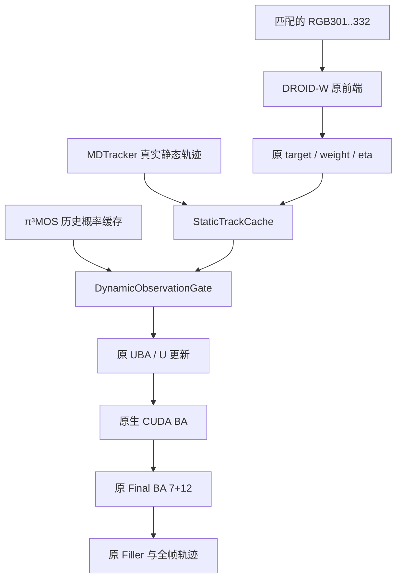

# TASK009 实际架构与接口

本轮为可运行的独立 Improved DROID-W 候选原型。主干网络、原 U/UBA 和原生 BA 保留；新增逻辑在 `DepthVideo.ba` 前修改观测输入。

图为两个模块同时启用时的实际调用顺序：静态适配器先改变 target，动态适配器随后在更新后的预测对应位置采样概率。
开关关闭时对应 hook 不安装。E0 两个 hook 都不安装，但仍属于本轮缩小协议而不是旧 R2 复现。

## 动态门控

`gamecam/modules/dynamic_prior/feature_alignment.py:ImageGeometry` 实现像素中心/stride 对齐。
`pi3_adapter.py:Pi3Cache` 根据原始 RGB ID 读取真实连续概率，拒绝身份不一致与非有限值。
`dynamic_mask.py:DynamicObservationGate` 计算 `G=max(floor,(1-Mi)^alpha*(1-Mj)^beta)`，并乘原始 weight。
`droid_adapter.py:install_video_gate` 根据 video.timestamp → 原始 RGB ID 找到两端；Mi 在源特征点采样，Mj 在 target 预测对应坐标采样。
越界采样有显式统计，未将目标帧的同像素位置冒充对应点；原 U 只由原生流程使用，没有重复乘入。
Confidence 只保存/显示，没有经 GT 验证，未偷偷乘入门控。

## 静态辅助

`gamecam/modules/motion_decomposition/droid_adapter.py:StaticTrackCache.observations` 将模型图像 x/y 按半像素 resize 映射到 DROID 图像，再除 stride=8。
两端 visibility≥0.9、dynamic≤0.1、正深度、有限/界内坐标、源点距格点≤0.35 才可使用。
辅助目标为 `cell+(static_xy[b]-static_xy[a])/8`；以 `0.15*quality` 混合现有 target。
每个边/源格点只保留最高质量点，不新增重复边、不修改 weight、eta 或 U。
深度用于无效点筛选；原 K、pose、disparity 继续参与原生重投影 BA。
这是一项二维反事实静态重投影目标实验，不是独立测得的三维位移约束，也不是移植整套 BA-Track 后端。

## 作用范围与时间信息

两个 hook 的实际范围是所有 `video.ba`，包含初始化、Frontend、Final BA、Filler；本轮没有做分阶段隔离。
MDTracker 从完整 32 帧窗口获得离线轨迹，不能宣称因果在线模块或实时系统。
Pi3 缓存身份固定；不启动 TASK008 服务器，不重做模型训练。
强制每2帧关键帧的本地协议使九组均16关键帧，不支持“改善自然关键帧选择”的结论。

## 可重跑入口

统一说明配置：`configs/task009/local_exploration.json`；实际逐组收据与 YAML 优先于该事后汇总。
原生入口 `experiments/TASK009/scripts/run_native.sh` 配置 D: 上独立 WSL 环境。
运行器 `run_droid_window.py` 的 `--gate` 与 `--static-tracks` 可独立开关，alpha/beta/floor 可显式设定。
无需修改生产 DROID-W 或其 YAML 来开关候选。
