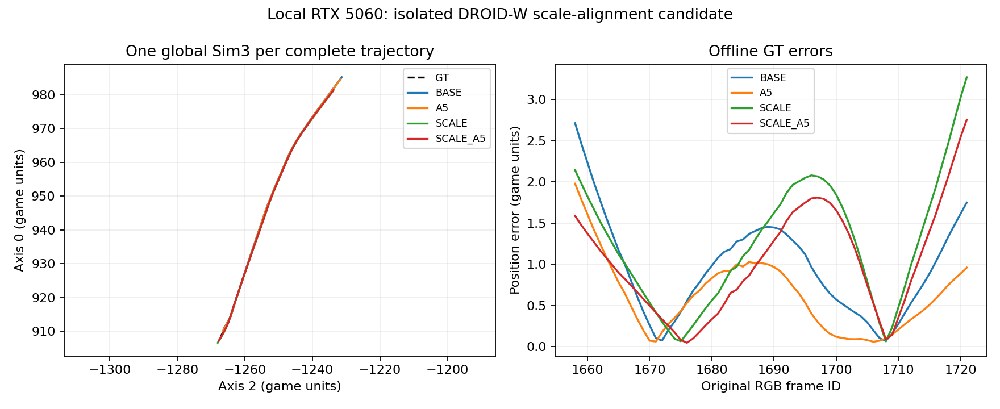

# 本地 DROID-Splat 尺度校正迁移：最终评审

日期：2026-11-28（Asia/Shanghai）。状态：**LOCAL_PILOT_COMPLETE / SCALE_CANDIDATE_NOT_PROMOTED**。

**已在本地 RTX 5060 8GB 完成四组真实 DROID-W 推理和离线评分。当前 scale-only 校正没有改善这个窗口；A5 最好。远端 TASK011E-R4 未连接、未查询、未修改。**

## 结果

VIPER **Train / Day004 / RGB1658–1721**，64 帧、stride=1、seed43。Camera1657–1720。
所有平移指标使用 VIPER 游戏单位，**未建立米制单位**。ATE 越低越好。
完整轨迹只拟合一个全局 Sim3 尺度；RPE 使用该全局尺度，不对各个区段另拟合。

| 组 | Sim3 ATE | SE3 ATE | 平移 RPE1 | 平移 RPE15 | Sim3 ATE 相对 BASE | 原始路径/GT |
|---|---:|---:|---:|---:|---:|---:|
| BASE | 1.124538 | 4.532318 | 0.130821 | 1.573843 | +0.00% | 1.1683 |
| A5 | 0.759294 | 1.820581 | 0.094699 | 1.092545 | -32.48% | 1.0556 |
| SCALE | 1.465964 | 6.484171 | 0.168691 | 2.153908 | +30.36% | 0.7282 |
| SCALE_A5 | 1.213120 | 7.407194 | 0.142167 | 1.812671 | +7.88% | 0.6876 |

SCALE+A5 的 Sim3 ATE 相对 A5 上升 **59.77%**。四组均完整输出 64 个位姿，保留 52 个关键帧，**关键帧 ID 完全相同**（Jaccard=1）。
这次窗口不支持“新增尺度校正改善当前 Baseline”的假设，不能据此否定完整 DROID-Splat 系统，或推广至其他环境。

## 接入了什么

参考 DROID-Splat 固定源码 `f0cb0316e1ee7f88f8a63c37a6fe19dd623e6eb2` 中 `linear_align_prior` 和加权尺度/偏移求解，移植**固定相机、估计地图对齐的逐帧 disparity scale-only**。shift 固定为 0。
候选对原始 Metric3D disparity 计算尺度，在独立 BA 调用中使用校正先验，不累计修改原始先验。
只作用于 Frontend Main-loop Local BA；初始化、第二阶段初始化、Final BA、Filler 走原生路径。
原生 U/UBA 保持；A5 仅改变深度正则强度，不改几何 UBA 权重。完整公式和作用范围见 [IMPLEMENTATION_AND_MATH.md](IMPLEMENTATION_AND_MATH.md)。

**这不是完整 DROID-Splat 复现**：没有 Gaussian mapping、JDSA、偏移优化或完整交替优化。把先验对齐到估计地图，也不等于恢复物理米制尺度。

## 拟合实际生效与负结果

SCALE_002 有 1260 条拟合记录、561 条通过；SCALE_A5_002 有 1260 条、562 条通过。记录数不是独立实验样本。
所有通过的拟合都降低了同一支持区域上的先验—地图 disparity MAE，但最终轨迹更差。
因此，当前结果说明**更贴合内部估计地图，不足以保证轨迹更接近 GT**。地图误差反馈和稀疏支持可能有关，但本轮未证明唯一因果机制。
部分单帧拟合仅有 1～2 个有效像素；300 像素门槛是全地图门槛。这是明确的估计稳定性局限，未在看到 GT 结果后追加阈值调参。

## 本地运行的共同条件

DROID-W 源码固定 `c3414af6047d06bafc1a6645d09f23247f3b2cdc`，原权重、K、Metric3D、DINO、原生 Tracker/Final BA/Filler 保留。
本地使用已有 WSL Python3.10、PyTorch2.7.1+cu128，buffer=96，单进程 Tracker，缓存公共 prior/features；关闭在线 Viewer。
64 帧加 Filler 16 槽没有容量淘汰。该本地协议不替代远端 buffer500 正式协议。
Metric3D 可选 xFormers 注意力在本地 sm120 不兼容，运行时替换为 SDPA；所有组相同，不能声称与远端 cu118 逐位等价。
显存峰值 allocated 约 5.302GiB，reserved 约 6.355～7.078GiB。该量不包含整台桌面的所有显存。

## 验证与尝试完整性

- CPU 数学、控制边界与离线评分测试：**36/36 PASS**。
- 冻结导出源码：**208 个 Git blob 核验通过**，CRLF 差异已明确记录。
- 与既有 full-sequence 评价程序交叉核验：**32 个字段全部一致**。
- A5 首个真实 Local BA 状态上，原安装扩展重复、候选关闭、全 1 强度端点：**21 项容差比较通过**，最大绝对差约 4.77e-7。这是单状态局部验证，不是全场景 Native 等价证书。
- 共享三份 Checkpoint 与原安装 CUDA 扩展 SHA-256 保持一致。
- 共 8 次 Tracker 尝试：2 次失败、2 次完整但尺度未激活、4 次正式完整对照。全部日志保留，见 [ATTEMPT_ACCOUNTING.md](ATTEMPT_ACCOUNTING.md)。

初始 Day001 近静止窗口无法初始化；统一改用历史已验证有运动的 Day004。Day004 首次运行因显存碎片 OOM，后续各组统一启用 expandable_segments。
第一版尺度组因门槛适用范围错误而全部回退单位尺度；在轨迹评分之前按官方源码修正，只重跑两组尺度候选。未激活轨迹也公开评分，未混入正式结果。

## 研究决定与边界

**保留 A5 与原始 BASE，本候选封存，不接入生产 Baseline，不扩大实验。**
只有一个 Train 开发窗口、一个 seed，没有置信区间或跨环境泛化结论。这里报告总轨迹效果，未冻结 BA 中间输入做因果重放。
如果后续获批准继续，优先在已有状态上检查尺度拟合支持和地图误差反馈；先确定可辨识的尺度约束，不能直接以当前地图替代真实尺度。当前不自动开发偏移/JDSA，不启动新序列。

## 完整审查入口

- [数学和接入](IMPLEMENTATION_AND_MATH.md)
- [本地兼容与协议差异](LOCAL_RUNTIME_COMPATIBILITY.md)
- [全部尝试](ATTEMPT_ACCOUNTING.md)
- [来源与许可证](SOURCE_PROVENANCE.md)
- [局限和下一步](LIMITATIONS_AND_NEXT_STEP.md)
- [精确指标 CSV](candidate/evaluation/FOUR_ARM_METRICS.csv)
- [最终证据核验](candidate/reports/FINAL_EVIDENCE_VALIDATION.json)
- [归档范围](PACKAGE_CONTENTS.md)；全部文件由 `SHA256_MANIFEST.csv` 覆盖。

本阶段在本地完成。没有读取远端运行状态，因此不对服务器当前进度作判断。
