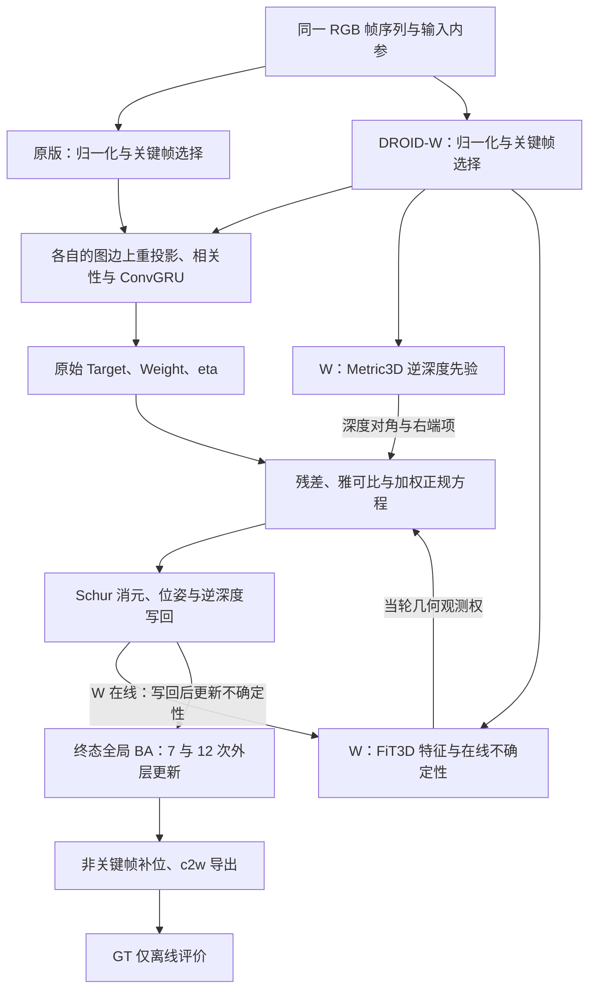

# GameCam-VO Task 001：DROID-SLAM 与 DROID-W 静态源码审计

**审计完成；正式证据采用 VIPER `stride=1`。** `val_007` 的导出轨迹存在局部平移压缩，源码给出了应检查的几条路径；现有正式存档无法确定压缩首次出现的阶段，也无法把根因归给 Metric3D、不确定性或 BA 中的任一项。历史 `stride=4` 分支停止推进，其原始记录保留；旧观测器和 BA280 记录不用于本报告的定位与归因。

证据分级：`CONFIRMED` 表示固定源码、正式配置或经核验的存档直接支持；`INFERRED` 表示源码允许的解释，尚无本案例的运行证据；`UNVERIFIED` 表示关键证据缺失。源码确认的是计算路径；存档确认的是对应协议下的输入与结果。

## A. 版本与来源

| 项目 | DROID-SLAM | DROID-W |
| --- | --- | --- |
| 官方来源 | `princeton-vl/DROID-SLAM` | `MoyangLi00/DROID-W` |
| 正式提交 | `2dfd39f0dcad44012ca7bbb8aa70b55edbfa9c99` | `c3414af6047d06bafc1a6645d09f23247f3b2cdc` |
| Git tree | `7ab46b59d34893957fe7c88d5d8d6e6bb842e4dc` | `5b0eb293baf41b8267fc656ca34c23a7b421c44f` |
| 归档 SHA-256 | `8a942b151558ef293cd5eff260eaeef0ae88f576128776c91397eb7b1d9bdecf` | `b5c9de72dd5a2cb7ad2c00274150cdf2b05bbabda7887b362a7abc234f11ee13` |
| 校验覆盖 | 104 个文件对象、2 个子模块指针 | 208 个文件对象、3 个子模块指针 |
| 正式运行入口 | 原版同步 `Droid`；归档的 `pipeline/run_original.py:27–56` | 官方 DROID-W；复用封存参考运行与配置 |

`CONFIRMED`：两份历史官方下载归档和本地展开快照均与锁定提交的树、文件字节及 Git 对象身份匹配。历史服务器记录中，入库 `HEAD` 匹配，工作区状态记录均无条目，部署追踪文件差异为 0。输入分段、图像预处理、调用和导出包装单独保存在 R2 目录里；此处对照的是两个官方核心源码版本加各自实际启用的配置。

`UNVERIFIED`：本地是无 `.git` 的快照，历史记录未提供检出分支名，当前实例状态未检查。子模块指针核验并不覆盖递归依赖源码或运行时二进制的等价性。完整路径与核验结果见 [SOURCE_IDENTITY_VERIFICATION.json](evidence/SOURCE_IDENTITY_VERIFICATION.json)。

## B. 完整差异清单

[SOURCE_DIFF_MASTER.csv](evidence/SOURCE_DIFF_MASTER.csv) 覆盖全部 285 个文件对照项：新增 179、移除 74、同路径修改 7、移位并修改 22、移位且内容一致 2、原路径不变 1。清单登记文件路径、变化性质、对象哈希及适用的代码位置。移位配对是审计映射，并非 Git 历史重命名主张。表中的旧 `val007_relevance`、`inference_path`、`reason` 等列按历史索引原样保留，只用于查找源码；它们不证明正式 `stride=1` 的运行分支、现象或因果。

[FUNCTION_DIFF_LEDGER.csv](evidence/FUNCTION_DIFF_LEDGER.csv) 保留 1,003 条函数、类及原生符号的历史索引，包含位置与签名；本轮复核了文件对照与行号范围。结构相等是索引分类，不能代替运行结果等价证明。[ARCHITECTURE_AND_BA.md](ARCHITECTURE_AND_BA.md) 逐项解释正式路径里有计算影响的差异，从特征提取一直追到最终导出。

完整源码与补丁保留在 `D:\aaa\GameCam-VO\experiments\DROID_SLAM_TO_DROID_W_SOURCE_DIFF_EVIDENCE_MAPPING_R1`：`sources\DROID-SLAM`、`sources\DROID-W`，以及 `evidence\OFFICIAL_TEXT_DIFF.patch`（24,391,944 字节；SHA-256 `7a46717b83130667a3935efc06e6a3cf1c4e65807f65f83bed52bc1b430882a1`）。轻量包不复制这些大文件。

## C–G. 从相同输入到不同轨迹

| 分类 | 关键源码路径 | 对平移估计的实际影响 |
| --- | --- | --- |
| `CONFIRMED` 共用骨架 | 原版 `droid_slam/droid_net.py:44–169`、`factor_graph.py:215–258`；W `src/modules/droid_net/droid_net.py:48–161`、`src/factor_graph.py:236–282` | 两者都由当前重投影查相关特征，再由 ConvGRU 预测二维观测修正和权重。相机平移来自位姿优化，没有独立的平移预测头。匹配网络相同职责不能保证图、输入张量或每轮观测相同。 |
| `CONFIRMED` 状态与图 | 原版 `droid_slam/droid_frontend.py:49–155`；W `src/frontend.py:56–212`、`src/tracker.py:109–118` | 暖机、候选删除时机、初始位姿和视差种子不同。W 首轮由未启用 UBA 过渡至启用 UBA，还有跟踪器门限触发的第二阶段初始化。图的选择可改变能约束平移的视差和时间跨度。 |
| `CONFIRMED` Metric3D | W `src/motion_filter.py:68–110`、`src/lib/droid_kernels.cu:1857–1914`；原版 `src/droid_kernels.cu:1395–1437` | 正式原版从 RGB 单目入口传空传感器深度。W 从 RGB 生成先验，在有效像素改变联合 BA 的逆深度对角与右端项，再经位姿与深度的交叉项影响位姿。W 正式在线先验系数为 `0.01`；不能仅从系数推断增量方向。 |
| `CONFIRMED` 不确定性 | W `src/depth_video.py:145–167`、`src/lib/droid_kernels.cu:317–362,1915–1984` | 启用 UBA 时，源像素 `U` 对网络权重做几何行重加权；目标端门控在正式配置中关闭。几何写回后更新 U，新的 U 能影响后续内部迭代。U 不是动态物体真值掩码。 |
| `CONFIRMED` 位姿和视差回写 | 原版 `src/droid_kernels.cu:907–956,1395–1437`；W `src/lib/droid_kernels.cu:955–1004,1857–1914` | 两版均对 SE(3) 位姿用增量更新，对逆深度加 `dz`。原生返回后视差最小值约束分别为 `0.001`、`1e-5`；没有正式逐次 `dz` 证据证明本案例触及该约束。 |
| `CONFIRMED` 最终 BA 与导出 | 原版 `droid_slam/droid.py:71–85`、`droid_backend.py:24–42`；W `src/slam.py:128–183`、`src/backend.py:42–95`、`src/trajectory_filler.py:42–98` | 两版终态各做 7、12 次外层全局更新计划。原版单目全局调用前有尺度归一；W 正式配置不归一，最终直接 mono 正则关闭、保留 UBA，且不更新 U。最终导出前还会做非关键帧的 pose-only 补位。 |

`CONFIRMED`：相对投影可写成 `q = R_ji x + ρ t_ji`，其中 `x` 是源像素的归一化射线，`ρ` 是逆深度。投影残差用 `Target − project(q)`。因此视差状态会改变平移的局部雅可比；深度对角 `C`、右端 `w` 和耦合项 `E` 进入 `S = H − E C⁻¹ Eᵀ`、`b = v − E C⁻¹ w`。两版都在消元后求位姿增量，再回代求视差增量。阻尼、有效性门控、`motion_only` 分支及坐标解释见架构报告。`INFERRED`：弱视差、观测权选择和先验之间的交互可改变平移信息；当前没有本案例的 `S,b,dx,dz` 记录可检验这种解释。

## H. 正式 `stride=1` 的 `val_007` 证据

`CONFIRMED`：从 `D:\aaa\GameCam-VO\experiments\VIPER_MATCHED_DUAL_BASELINE_R2\evaluation` 的正式封存版读取，没有使用中间快照。92/92 区段配对已评分，覆盖 47 条 Validation 序列、49,815 帧；其中 82 个固定内参区段用于主比较，10 个虚拟相机区段是单列诊断。此处独立评价每个区段，不连接各段轨迹。离线评分按封存规则 `RGB ID − 1` 配对官方相机表；GT 位姿只参与离线评分。该映射核验并非独立的物理时钟同步验证。详细证据见 `evidence/MATCHED_R2_INPUT_PAIRING_AUDIT.md` 和 `evidence/MATCHED_R2_PAIRED_SEGMENT_COMPARISON.csv`。

`val_007_full_00001-00487` 属于 Night 固定 K 组。两版接收相同的 487 个连续 RGB ID、640×360 图像和输入 K，导出 487 个有限位姿；最终分别保留 77 和 85 个关键帧。导出位姿包括补位，不能用这个覆盖率替代前端跟踪成功率。

| 正式观测 | DROID-SLAM | DROID-W |
| --- | ---: | ---: |
| 全段 Sim(3) ATE（游戏单位） | 8.558 | 53.131 |
| 全段 SE(3) ATE（游戏单位） | 146.032 | 146.916 |
| 全段 Sim(3) 估计到 GT 的尺度 | 19.3379 | 19.1711 |
| RGB 309→325 位移 / GT；方向误差 | 1.021；0.81° | 0.450；7.85° |
| RGB 301→353 位移 / GT；方向误差 | 1.007；1.00° | 0.484；4.11° |

每个模型只用各自全区段的一次 Sim(3) 拟合，两个区间均无局部再缩放。这说明 DROID-W 在这些区间的**导出相机中心位移长度**比参考短约 52%–55%，不能靠一个全局尺度解释。方向误差是同一对端点的位移方向误差，不是相机姿态角误差。两区间重叠，不能当作两个独立异常样本，也不能推广为 Night 全组的同一根因。原值与计算口径在 [MATCHED_R2_VAL007_LOCAL_DISPLACEMENT.csv](evidence/MATCHED_R2_VAL007_LOCAL_DISPLACEMENT.csv)；单位保留为游戏单位。

| 候选解释 | 证据状态与最有区分力的观测 |
| --- | --- |
| 前端接受、剔除、图边与学习观测 | `INFERRED`：不同门限和删除规则、77/85 个终态关键帧支持核查这条路径。需按真实 RGB ID 恢复候选时间线、图边跨度、当前投影和目标；关键帧数不能定位问题。 |
| 先验与位姿、逆深度联合求解 | `INFERRED`：源码给出 `C,w,E` 的作用路径。需同轮同状态的先验、稀疏系统、`dx,dz` 和写回结果；没有数据支持正式案例已出现早期历史中的负逆深度。 |
| UBA 压低有用的平移观测 | `INFERRED`：门控可能让高视差或特定方向的观测贡献变小，也可能抑制坏匹配。需对照原始网络权、有效几何权和方向性信息，不能从 U 热图或 ATE 直接判断。 |
| 最终 BA 加剧或产生压缩 | `UNVERIFIED`：版本间最终优化路径可静态区分；本案例缺少精确端点在两轮最终 BA 前后的可比记录。 |
| 补位或导出加剧或产生压缩 | `UNVERIFIED`：要区分真实存活的关键帧、插值种子、pose-only 后结果和 c2w 导出。现有全帧位姿不表示每一帧都被直接优化为关键帧。 |

## I–J. 下一步与停止条件

最有信息量的下一步是：**只沿正式 `stride=1` 合同取证，按准确 RGB ID 找到压缩首次出现的阶段。** [INSTRUMENTATION_PROPOSAL.md](INSTRUMENTATION_PROPOSAL.md) 给出保留到达、入队、删帧、在线 BA、两次最终 BA、补位和导出的证据安排。对缺少端点的中间状态标为缺失或单列估计。先有阶段定位和状态对照，再谈单因素消融与改造优先级。

剩余问题：首次压缩发生在哪次状态更新？原始对应关系是否已失准？先验、门控和阻尼各改变了哪些平移观测？同状态求解是否稳定？补位是否改变了这两个区间的估计长度？这些问题目前均未闭合。可保留“游戏场景的局部平移估计可靠性”作为研究问题，尚不能把特定 BA 改进或深度先验修复定为论文结论。

本轮仅使用本地历史证据与静态源码，未连接服务器、启动 GPU/CUDA、执行模型、运行 VIPER 或应用埋点。原版 DROID-SLAM、DROID-W、实验协议和历史结果保持冻结。状态：`TASK001_STATIC_AUDIT_COMPLETE_ROOT_CAUSE_UNRESOLVED`。
