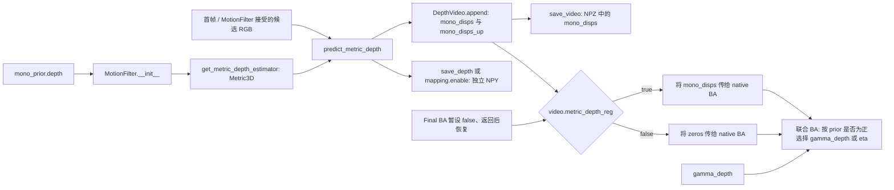
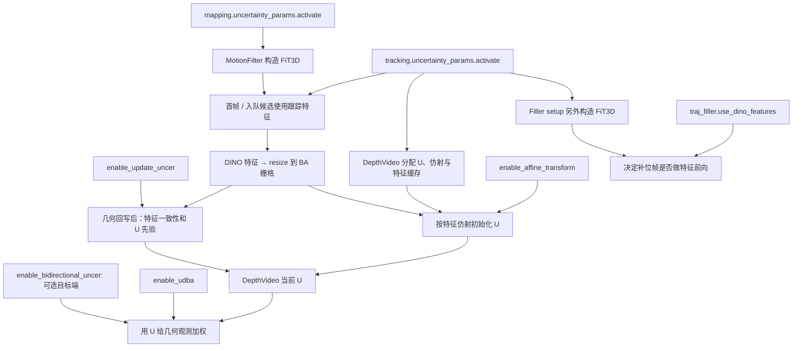
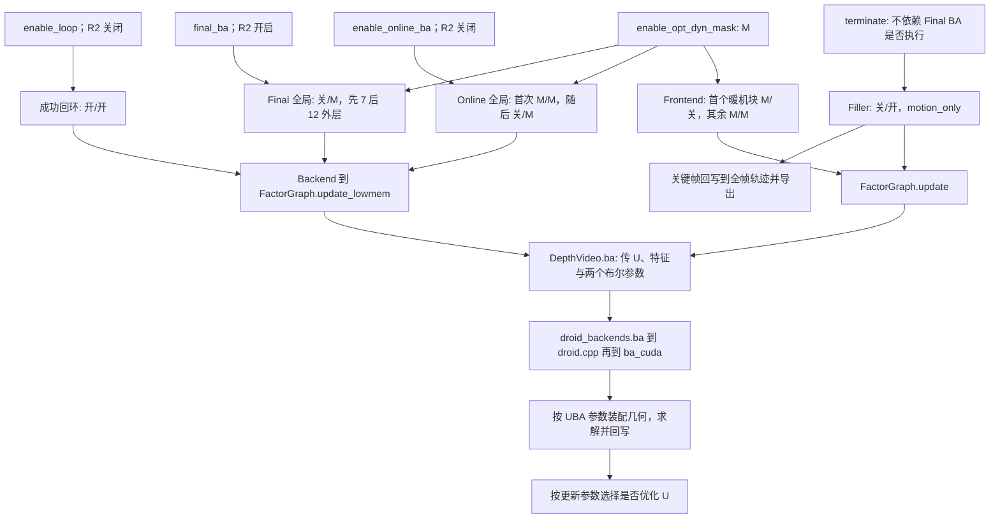

# Task 002A｜DROID-W 模块依赖图

**CONFIRMED：** 源码将三个操作分开：生成 Metric3D 先验、优化 U、用 U 调整 BA 几何权重。正式 `stride=1` R2 通过阶段调度给求解器传参数；是否开启原生求解器的一条路径，不能只由参数名或保存文件反推。

本图只引用已核验的 DROID-W `c3414af6047d06bafc1a6645d09f23247f3b2cdc`。`W:` 指 `D:\aaa\GameCam-VO\experiments\DROID_SLAM_TO_DROID_W_SOURCE_DIFF_EVIDENCE_MAPPING_R1\sources\DROID-W`；`R1:` 指 `D:\aaa\GameCam-VO\experiments\DROIDW_VIPER_ZERO_SHOT_TRANSFER_R1`。图中路径与调用关系为 **CONFIRMED（静态）**，不代表新组合已运行。正式快照和 Git 对象验证见 [配置核验](/D:/aaa/GameCam-VO/experiments/DROID_W_TASK002A_ABLATION_SWITCH_DEPENDENCY_AUDIT/DROID_W_R2_CONFIG_VERIFICATION.md)。

## 1. Metric3D：构造、预测、存储、优化

- **CONFIRMED：** `Tracker` 创建 `MotionFilter`，后者总是调用模型工厂。R2 `metric3d_vit_large` 的构造路径和预测函数都与 `metric_depth_reg` 分离。`predict_metric_depth` 的返回值无条件进入入队参数，保存 `.npy` 则另有条件。证据：[构造](/D:/aaa/GameCam-VO/experiments/DROID_SLAM_TO_DROID_W_SOURCE_DIFF_EVIDENCE_MAPPING_R1/sources/DROID-W/src/motion_filter.py:32)、[跟踪预测](/D:/aaa/GameCam-VO/experiments/DROID_SLAM_TO_DROID_W_SOURCE_DIFF_EVIDENCE_MAPPING_R1/sources/DROID-W/src/motion_filter.py:97)、[模型工厂](/D:/aaa/GameCam-VO/experiments/DROID_SLAM_TO_DROID_W_SOURCE_DIFF_EVIDENCE_MAPPING_R1/sources/DROID-W/src/utils/mono_priors/metric_depth_estimators.py:24)。
- **CONFIRMED：** 先验写到单独的缓存；此版本没有在正常暖机启用 `init_w_mono_disp` 来覆盖优化变量。BA 入口只有 `mono_disps`/零先验二选一；不因关闭约束而清除缓存。`motion_only` 不进入联合深度分支。证据：[先验存储](/D:/aaa/GameCam-VO/experiments/DROID_SLAM_TO_DROID_W_SOURCE_DIFF_EVIDENCE_MAPPING_R1/sources/DROID-W/src/depth_video.py:127)、[BA 入口](/D:/aaa/GameCam-VO/experiments/DROID_SLAM_TO_DROID_W_SOURCE_DIFF_EVIDENCE_MAPPING_R1/sources/DROID-W/src/depth_video.py:347)、[native 分支](/D:/aaa/GameCam-VO/experiments/DROID_SLAM_TO_DROID_W_SOURCE_DIFF_EVIDENCE_MAPPING_R1/sources/DROID-W/src/lib/droid_kernels.cu:1867)。另外，mapper 读取的是 `get_depth_and_pose` 等路径按同一个标志选出的深度；这条依赖在 mapping-off R2 未进入。

## 2. FiT3D/DINO 与 U：两处 activate、三种作用

| tracking U | mapping U | 构造 / 推理 / 状态 | 静态判断 |
| --- | --- | --- | --- |
| `true` | `true` | MotionFilter 有 extractor；预测跟踪特征并初始化 U；filler 另行 setup | **CONFIRMED**：R2 分支。`mapping.enable=false` 仍成立。 |
| `true` | `false` | 跟踪要读 `feat_extractor`，但 MotionFilter 构造未赋值 | **CONFIRMED**：缺失属性路径。**INFERRED**：在首帧失败。 |
| `false` | `true` | 仍算 FiT3D，走 mapping U 的强制保存分支；跟踪 U 缓存、仿射参数没有分配 | **CONFIRMED**：tracker 仍先读 `enable_affine_transform`，正常 BA 与 `save_video` 也使用缺失属性。**INFERRED**：不能安全完成。 |
| `false` | `false` | MotionFilter 不构造或预测 FiT3D；filler 不构造，跟踪 U 状态也缺失 | **CONFIRMED**：未解决 tracker/BA/导出的无条件访问。**INFERRED**：不是可运行的纯配置消融。 |

**CONFIRMED：** `enable_update_uncer` 读当前几何状态、源/目标侧特征和 U，用 `gamma_data` 与 `gamma_prior` 组合更新，仿射打开时还应用 `lr` 和 `weight_decay`。`enable_udba` 则在几何方程装配时读 U，乘到原始网络观测权重；双向只在这条几何路径增加目标侧乘数。先装配几何并回写 pose/disp，再选择是否更新 U；本轮产生的 U 可在后续内层或外层被 UBA 读取。该依赖不会把两个布尔分支合并。见 [U 初始化](/D:/aaa/GameCam-VO/experiments/DROID_SLAM_TO_DROID_W_SOURCE_DIFF_EVIDENCE_MAPPING_R1/sources/DROID-W/src/depth_video.py:145)、[几何权重](/D:/aaa/GameCam-VO/experiments/DROID_SLAM_TO_DROID_W_SOURCE_DIFF_EVIDENCE_MAPPING_R1/sources/DROID-W/src/lib/droid_kernels.cu:320)、[U 更新](/D:/aaa/GameCam-VO/experiments/DROID_SLAM_TO_DROID_W_SOURCE_DIFF_EVIDENCE_MAPPING_R1/sources/DROID-W/src/lib/droid_kernels.cu:1915)。

## 3. 调度层：谁把两项设置传给求解器

- **CONFIRMED：** 图中每个“更新/UBA”对的第一项是 `enable_update_uncer`，第二项是 `enable_udba`。`M=false` 不覆盖填帧和回环的硬编码。前端 warmup、在线间隔、Final 的 7+12 与原生内层次数详见 [BA 阶段报告](/D:/aaa/GameCam-VO/experiments/DROID_W_TASK002A_ABLATION_SWITCH_DEPENDENCY_AUDIT/DROID_W_BA_STAGE_CONTROL_REPORT.md)。`enable_wq` 虽转发到 `update_lowmem`，没有条件分支消费它。
- **CONFIRMED：** 冻结 runner 的 [有效配置门禁](/D:/aaa/GameCam-VO/experiments/DROIDW_VIPER_ZERO_SHOT_TRANSFER_R1/pipeline/run_segment.py:197) 要求深度正则、Final BA 开启且 `gamma_depth=0.01`；历史 [补位 phase 记录](/D:/aaa/GameCam-VO/experiments/DROIDW_VIPER_ZERO_SHOT_TRANSFER_R1/pipeline/run_segment.py:166) 依赖 `backend()` 正常返回。这是实验脚本约束，不是 CUDA 接口需要这些取值。
- **INFERRED：** 想分开检验 U 更新和 UBA，应保留 U 布局与特征生成，只在隔离的实验入口改变明确阶段的两个实参。几何状态与 U 的数值反馈是被研究的效应；只读审计不能给出其大小与方向。
- **UNVERIFIED：** 新调用组合的运行兼容性、实时错误、速度和轨迹效果未测；当前 live checkout 与递归依赖内容不是本图的凭据。DROID-SLAM `2dfd39f0dcad44012ca7bbb8aa70b55edbfa9c99` 仅作已核验的源码比较锚点，其 [BA 接口](/D:/aaa/GameCam-VO/experiments/DROID_SLAM_TO_DROID_W_SOURCE_DIFF_EVIDENCE_MAPPING_R1/sources/DROID-SLAM/droid_slam/depth_video.py:213) 没有上述 U 参数；不从其行为推定 DROID-W 行为。
