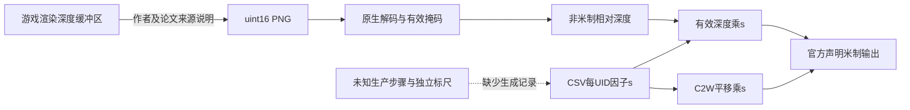

# 尺度生成机制：已连通与未连通的链条

## 已连通的消费路径

该图的虚线是本轮实际未闭合部分；不能用Reader成功读取s来填补它。

原生形式，`x=raw.astype(float32)/65535`，`near=1, far=1000`：

\[
D_r=\frac{x}{1000-999x}\frac{1}{0.004},\qquad
D_{out}=s_{UID}D_r.
\]

有效mask为 `not(x<0.0015 or x>65500/65535)`；无效像素置-1，只有有效深度乘s。
官方同时将W2C逆为C2W、仅对平移乘s，再求逆返回W2C。K和旋转不因这个全局尺度而变化。
TASK007C已实际验证9对解码/mask逐位等价；本轮保留该历史记录，不再读取新图像或运行模型。

## 0.004的含义

作者明确将其解释为数值缩放，而非独立米制换算。
它不能告诉我们游戏引擎单位如何对应米。
若同时将数值常量c改为c'、CSV因子s改成 `s'=s*c'/c`，输出 `s*f(x)/c` 完全不变。
因此仅从s的大小或小数位数，不能推断标定来源、预测器或物理准确性。
本轮仅用合成float64数组验证此重参数化，不修改实际Reader或CSV。

## 实际生产步骤仍未知

公开main的完整历史脚本只有下载、解压、读取/点云输出等用途；全部脚本变更已保存。
没有找到从独立距离、资产尺寸或预测深度计算这三个s的生产实现、日志和参数。
HF发布提交只上传了一份CSV，可见消息没有进一步计算说明。
“上传脚本使用huggingface_hub”与“因子生成算法使用什么模型”是两个问题。

## MoGe-2建议的可解释形式

对作者建议作数学释义，一种候选流程可能是：

\[
s=\operatorname{median}_{(f,p)\in\mathcal S}
\frac{D_{model}(f,p)}{D_r(f,p)}.
\]

这里集合S、有效掩码、跨帧聚合方式、预测器权重/分辨率/内参都需要生产记录确定。
该式**只是对建议的形式化，不是已确认的CSV生成公式**。
逐帧中位数再取中位数与把所有像素合并取中位数也不一定相同；不能擅自补全细节。

即使未来证实用的是MoGe-2，也只证明一条模型估计链路：
若没有独立长度验证，它不能自动提供物理标定及误差界。
“不是Metric3D预测”与“具有可信物理米制”必须分别证明。
如果因子来自Metric3D自身，再拿其作Metric3D尺度误差GT，会形成循环参照；本轮没有证据断言这种循环已发生。

## Test拟合与论文对齐评价的区别

论文附录C.1的尺度对齐用于评价预测形状，不能据此认定其公布成绩验证了绝对米制。
这也不是CSV生成时用了Test拟合的证据。
源CSV中016d的Test split为1/6/22/23、0caf为10；03b的该字段为空。
现有因子为每UID一个值，会应用到该UID各split，但计算时是否用了任何Test帧仍未知。
没有拟合帧清单，就不能认证无泄漏，也不能宣布已经发现泄漏。

## 三UID机制一致性

确认：三个因子同批进入2026-03-21 CSV，当前值一致，走同一Reader。
未确认：同一种算法、同一模型、同样采样/过滤、相同物理标尺或相同误差。
发布一致性不能替代生成一致性。
